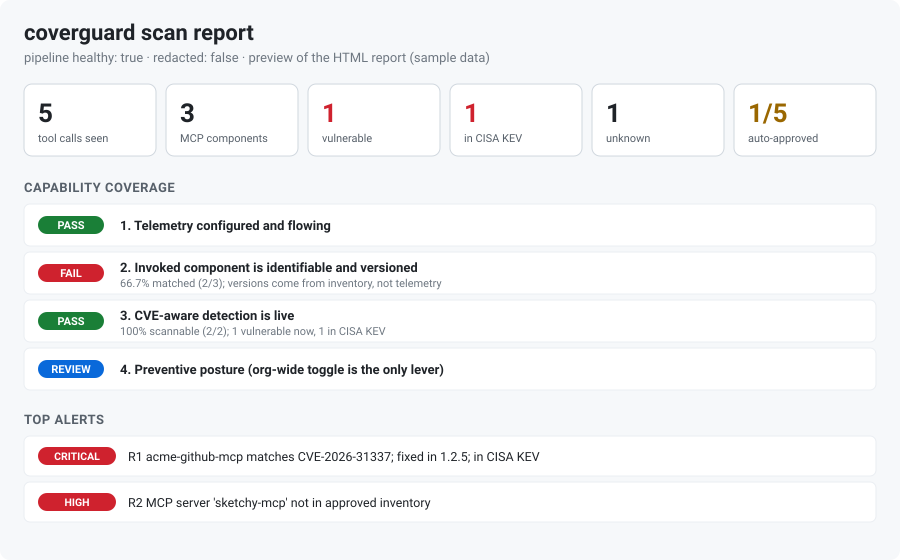
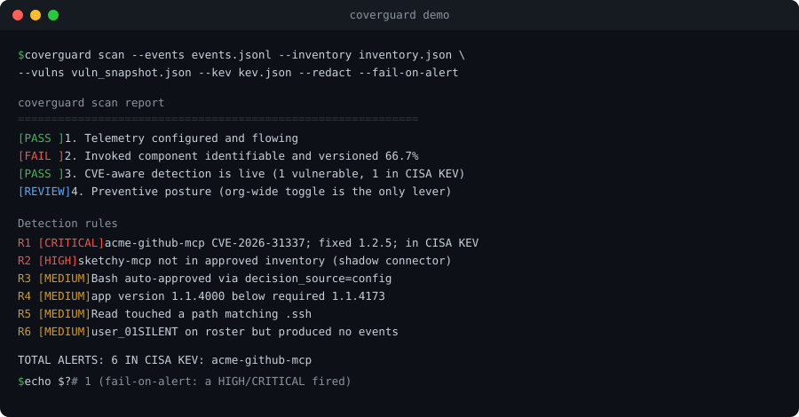

# coverguard

[](https://github.com/0xkhalsa07/coverguard/actions/workflows/ci.yml)
[](LICENSE)
[](pyproject.toml)

By Jagpreet Singh Bhatia ([@0xkhalsa07](https://github.com/0xkhalsa07))

**CVE-aware coverage for Claude Cowork tool calls.** coverguard answers one
question with evidence: for the tools and MCP connectors Cowork invoked on a
user's behalf, did any carry a known CVE, and how much of that visibility do we
actually have?

It ingests the OpenTelemetry events Cowork emits, matches invoked components
against a pinned inventory and a CVE feed, runs six detection rules, and prints a
coverage report that maps directly to four governance gaps. It has zero
third-party dependencies and runs offline by default.





## Contents

- [How it works](#how-it-works)
- [Requirements](#requirements)
- [Install](#install)
- [Try it in one minute](#try-it-in-one-minute)
- [Example output](#example-output)
- [Use it on your own data](#use-it-on-your-own-data)
- [Using it safely](#using-it-safely)
- [Commands and flags](#commands-and-flags)
- [Input files](#input-files)
- [Detection rules](#detection-rules)
- [Disclaimer and responsible use](#disclaimer-and-responsible-use)
- [Limitations and roadmap](#limitations-and-roadmap)
- [Documentation](#documentation)
- [Development](#development)
- [License](#license)

## How it works

The Cowork OTel stream names the component (`mcp_server_name`) but does not carry
its version; the only version in the stream is the Claude app version. CVE
matching needs a version, so the version comes from a pinned inventory you
maintain, and anything invoked that is not in that inventory is treated as an
alert in its own right (rule R2). This is an assume-breach stance: we do not
trust a name we cannot pin, and we never read absence of alerts as safety.

## Requirements

Python 3.8 or newer. Nothing else. No third-party packages to install, and no
network access unless you opt in with `--online`.

## Install

```bash
pip install .
# or, for development:
make dev
```

You can also run it without installing:

```bash
PYTHONPATH=src python -m coverguard --help
```

Install it as a command with pipx, straight from GitHub, isolated from your
system Python:

```bash
pipx install git+https://github.com/0xkhalsa07/coverguard
```

Or run it in a container, with no local Python at all. The image runs as a
non-root user; the flags below drop every extra privilege, and because
coverguard is offline by default you can cut the network entirely (drop
`--network none` only if you pass `--online`):

```bash
docker build -t coverguard:latest .
docker run --rm \
  --network none \
  --read-only \
  --cap-drop ALL \
  --security-opt no-new-privileges \
  -v "$PWD:/work" \
  coverguard:latest \
  scan --events /work/events.jsonl --inventory /work/inventory.json \
       --vulns /work/vuln_snapshot.json --out-html /work/report.html
```

## Try it in one minute

The repo ships with sample data so you can see it work before touching real
telemetry. From the project folder:

```bash
coverguard scan \
  --events examples/events.jsonl \
  --inventory examples/inventory.json \
  --vulns examples/vuln_snapshot.json \
  --roster examples/roster.json \
  --redact \
  --out-html report.html
```

This runs entirely offline against the bundled example. It fires all six rules
and writes a `report.html` you can open in a browser. Nothing leaves your
machine.

## Example output

The text summary printed to your terminal looks like this (trimmed):

```
coverguard scan report
============================================================
pipeline healthy (MCP telemetry present): True
events=7 tool_events=5 users=2 mcp_components=3

Capability coverage
------------------------------------------------------------
[PASS   ] 1. Telemetry configured and flowing
[FAIL   ] 2. Invoked component is identifiable and versioned
           66.7% matched (2/3); versions come from inventory, not telemetry
[PASS   ] 3. CVE-aware detection is live
[REVIEW ] 4. Preventive posture (org-wide toggle is the only lever)

Detection rules
------------------------------------------------------------
R1  Known-vulnerable component invoked            1 alerts
     - [HIGH] acme-github-mcp matches CVE-2026-31337; fixed in 1.2.5
R2  Unapproved / unknown component invoked        1 alerts
     - [HIGH] MCP server 'sketchy-mcp' not in approved inventory
...
TOTAL ALERTS: 6
```

The HTML report shows the same information as a clean, shareable page, and
`--out-json` writes a machine-readable version for a SIEM.

## Use it on your own data

Four steps. The commands assume you installed the `coverguard` command; if not,
prefix them with `PYTHONPATH=src python -m coverguard`.

1. Collect Cowork telemetry. Ask an administrator to turn on Cowork's
   OpenTelemetry export (Admin settings, Cowork) so tool and MCP invocations
   flow to your collector, then export those events to a file, one JSON event per
   line. See [docs/deployment.md](docs/deployment.md) for details. If export is
   not on, coverguard will correctly report that gap rather than a false
   all-clear.
2. Describe what is approved. Create an `inventory.json` listing the MCP
   connectors, plugins, and tools you have vetted, each with a pinned version.
   Copy [examples/inventory.json](examples/inventory.json) and edit it.
3. Get CVE data. Build an offline snapshot once and reuse it:

   ```bash
   coverguard refresh-vulns --inventory inventory.json --out vuln_snapshot.json
   ```

   or skip the snapshot and query live with `--online` on the scan.
4. Scan, safely.

   ```bash
   coverguard scan \
     --events your_events.jsonl \
     --inventory inventory.json \
     --vulns vuln_snapshot.json \
     --roster roster.json \
     --redact \
     --out-json report.json --out-html report.html \
     --fail-on-alert
   ```

   `--fail-on-alert` returns a non-zero exit code if a HIGH or CRITICAL finding
   appears, which makes it easy to run as a scheduled job or CI step that pages
   you when a known-vulnerable or unknown connector is invoked.

## Using it safely

coverguard is built to be safe by default, and a few habits keep it that way.

- Pass `--redact` unless you specifically need raw user identifiers; it replaces
  them with a per-run pseudonym.
- Reports can contain user identifiers and file paths. They are written
  owner-only (mode 0600), and the bundled `.gitignore` keeps them out of git.
  Do not commit real reports or store them unprotected.
- It runs offline by default. The only outbound connection is to a fixed OSV.dev
  URL, and only when you pass `--online` or run `refresh-vulns`.
- Integrity-gate your inputs in automated runs with `--inventory-sha256` and
  `--vulns-sha256` so a tampered file cannot silently weaken detection.
- Inputs are size-bounded to resist oversized or malformed files; tune with
  `--max-bytes` and `--max-events` if needed.

## Commands and flags

- `coverguard scan` runs detection and coverage over a set of events.
- `coverguard refresh-vulns` builds an offline OSV snapshot, plus a `.sha256`
  sidecar, for the components in your inventory.
- `coverguard verify` checks a file against an expected SHA-256.

Useful `scan` flags: `--online`, `--roster` (enables R6), `--redact`,
`--config` (tune rules and coverage bands), `--suppressions` (allowlist accepted
findings), `--kev` (flag known-exploited CVEs from a local CISA KEV file),
`--inventory-sha256` / `--vulns-sha256`, `--max-bytes` / `--max-events`,
`--fail-on-alert`, and `--audit-log`. Pass `--vulns` more than once to merge
several snapshots. Run `coverguard scan --help` for the complete list.

Outputs and enrichment. Write reports with `--out-json`, `--out-html`, and
`--out-sarif` (SARIF 2.1.0, which GitHub Code Scanning can ingest). With
`--online`, or a local `--kev` file, findings are enriched with CISA KEV flags
and EPSS scores, and a KEV match is escalated to CRITICAL.

## Input files

- Events: JSONL or a JSON array of `{event_name, attributes, resource}` records
  mirroring the Cowork OTel schema. `mcp_server_name` and `mcp_tool_name` are
  read from the `tool_parameters` field.
- Inventory: `{"components": [{"name", "type", "ecosystem", "package",
  "pinned_version", "owner", "justification"}]}`. The `ecosystem`, `package`,
  and `pinned_version` fields make a component scannable for CVEs.
- Vuln snapshot: OSV-shaped `{"advisories": [...]}`, matched by ecosystem,
  package, and version.
- Roster: a list of expected users or endpoints, which enables the silence rule
  (R6).

See the files in [examples/](examples/) for working samples of each.

## Detection rules

| Rule | Severity | Fires when |
|------|----------|------------|
| R1 | HIGH | An invoked component resolves, via the inventory, to a known CVE |
| R2 | HIGH | An invoked MCP component is not in the approved inventory |
| R3 | MEDIUM | A sensitive tool was auto-approved (`decision_source` config/hook) |
| R4 | MEDIUM | An endpoint is below the minimum Cowork app version |
| R5 | MEDIUM | A tool touched a sensitive path or secret |
| R6 | MEDIUM | A roster member produced no events (silence) |

The coverage report maps these to four gaps: telemetry flowing, component
identifiable and versioned, CVE-aware detection live, and preventive posture.
Bands are PASS (at least 95%), PARTIAL (at least 70%), FAIL (below 70%), plus
REVIEW and N/A.

## Disclaimer and responsible use

coverguard is provided for educational, research, and defensive security
purposes. It is shared in good faith, with positive intent, to help teams and
learners understand and improve their own security posture. It is offered as-is,
without warranty of any kind, under the Apache-2.0 license, and the author
accepts no liability for how it is used or for any consequences of its use.

Please use it responsibly and lawfully:

- Use it only on systems, logs, and data that you own or are explicitly
  authorized to analyze.
- It is an analysis and detection aid, not a guarantee of security. A clean
  report does not mean a system is safe, and it is not a substitute for
  professional security review.
- It performs no attacks, no exploitation, and no changes to any system. It only
  reads the telemetry you give it and produces a report. It takes no
  enforcement, remediation, or legal action, and it makes no legal or compliance
  determinations.
- The telemetry it reads can contain personal data. Handle it in line with your
  privacy and data-protection obligations, for example by using `--redact`,
  keeping reports access-controlled, and setting a retention policy.
- Findings can include false positives and false negatives. Verify before you
  act on them.

This project is independent and is not affiliated with, sponsored by, or
endorsed by any vendor named in its documentation. Please use it ethically and
in good faith.

## Limitations and roadmap

Known limitations, stated plainly:

- It is a detective control, not preventive. The only native prevention for
  Cowork is the org-wide connector toggle, which is outside this tool.
- Version fidelity is pragmatic. Common semver and PEP 440 forms are handled,
  but exotic schemes (calendar versions, distro revisions) may need care.
- CVE matching is only as strong as the pinned inventory, because the telemetry
  carries a component name but not a version. Rule R2 (unknown component) is the
  backstop for anything unpinnable.
- Feed coverage is incomplete for bespoke or internal MCP servers, which need
  manual review, not just feed matching.

Roadmap ideas: richer per-ecosystem version-range semantics, more data sources
alongside OSV, and publishing to PyPI. (A pipx install and a container image are
already available; see Install.)

## Documentation

- [Use case](docs/use-case.md)
- [Design](docs/design.md)
- [Threat model](docs/threat-model.md)
- [Security controls](docs/security-controls.md)
- [Deployment](docs/deployment.md)

## Development

```bash
make dev        # editable install with dev tools
make check      # ruff + mypy + bandit + tests
make cov        # tests with coverage (fails under 80%)
make scan       # run against the bundled examples
```

Contributions are welcome. See [CONTRIBUTING.md](CONTRIBUTING.md) and the
[Code of Conduct](CODE_OF_CONDUCT.md). Report vulnerabilities per
[SECURITY.md](SECURITY.md).

## License

Apache-2.0. See [LICENSE](LICENSE) and [NOTICE](NOTICE).

## Acknowledgements

Event schema grounded in Anthropic's
[Cowork monitoring documentation](https://claude.com/docs/cowork/monitoring).
Vulnerability data via [OSV.dev](https://osv.dev), the GitHub Advisory Database,
and the NVD. Not affiliated with or endorsed by Anthropic.
