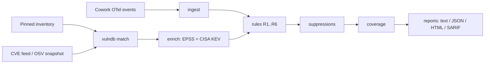

# Design

## Overview

coverguard is a small pipeline: load events and reference data, match components
to CVEs, enrich, run detection rules, apply suppressions, compute coverage, and
render reports. It is a library with a thin CLI on top, so the same logic can be
embedded in a SIEM job.

## Architecture



## Module map

| Module | Responsibility |
|--------|----------------|
| `models` | Data types: `Event`, `Component`, `Finding`, `Alert`, `RuleResult` |
| `versions` | Version parsing and OSV range comparison |
| `ingest` | Load events and JSON inputs with size and count guards |
| `inventory` | The pinned component inventory (name to version) |
| `vulndb` | Offline OSV-shaped matching, live OSV.dev lookups, snapshot refresh |
| `rules` | Detection rules R1 to R6 |
| `coverage` | The capability matrix and metrics |
| `report` | Text, JSON, and HTML rendering (all output escaped) |
| `report_sarif` | SARIF 2.1.0 output for GitHub Code Scanning |
| `enrich` | Optional EPSS scores and CISA KEV flags |
| `config` | Optional JSON tuning of rules and coverage bands |
| `suppress` | Allowlist of accepted findings |
| `security` | Size guards, integrity checks, redaction, safe writes |
| `errors` | Typed, user-facing errors with documented exit codes |
| `cli` | Argument parsing, orchestration, logging, error handling |

## Data flow

```
events.jsonl ─┐
inventory.json ┼─► ingest/inventory/vulndb ─► rules ─► coverage ─► report (text/json/html)
vuln_snapshot ─┘                                 │
roster.json ─────────────────────────────────────┘ (R6)
```

A single `prompt.id` links all events from one user prompt, so an analyst can
reconstruct a whole action chain from any alert.

## Key decisions

**The inventory is the source of truth for versions.** The OTel stream provides
`mcp_server_name` but not a component version. Rather than guess, coverguard joins
the observed name to a pinned inventory that carries the version. This makes R1
(known-vulnerable) only as strong as the inventory, and makes R2 (unknown
component) the necessary backstop for anything unpinnable.

**Offline first.** CVE data defaults to a local OSV-shaped snapshot so runs are
deterministic and air-gap friendly. `--online` and `refresh-vulns` use a constant
OSV.dev URL, never one derived from input, so there is no SSRF surface.

**Zero runtime dependencies.** The tool uses only the Python standard library.
This minimises supply-chain risk and lets it run anywhere Python 3.8+ exists.

**Detective by design.** coverguard observes and reports. The only native
prevention for Cowork is the org-wide connector toggle, which is out of the tool's
control, so the tool focuses on high-fidelity detection and honest coverage.

## Data formats

- Events: JSONL or a JSON array of `{event_name, attributes, resource}` records
  mirroring the Cowork OTel schema; flat records are tolerated.
- Inventory: `{components: [{name, type, ecosystem, package, pinned_version,
  owner, justification}]}`. `ecosystem`, `package`, and `pinned_version` make a
  component scannable.
- Vuln snapshot: OSV-shaped `{advisories: [...]}` matched by ecosystem, package,
  and version.
- Roster: a list of expected users/endpoints, enabling R6.

## Extensibility

New rules are added in `rules.py` as small methods returning a `RuleResult`; they
compose into `Detector.run`. New CVE sources implement the same shape as `VulnDB`
(a `match(component) -> [Finding]`). Report formats are added in `report.py`
without touching detection logic.
